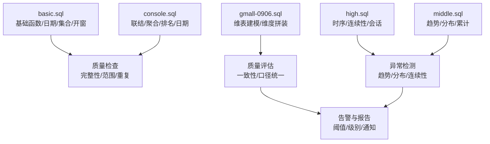
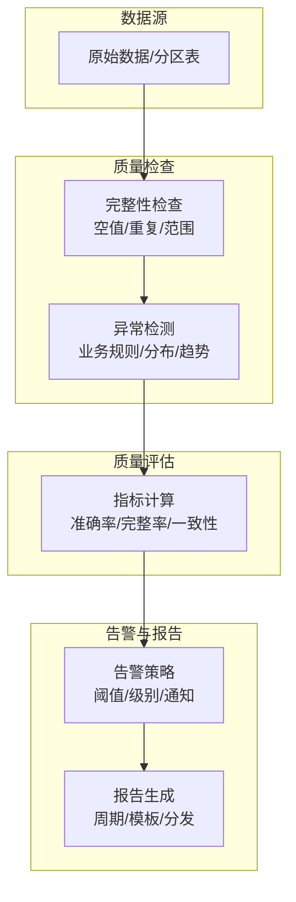
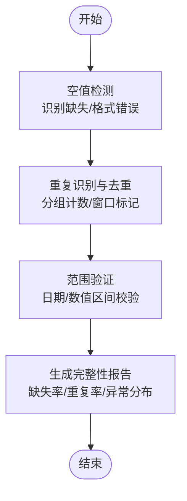
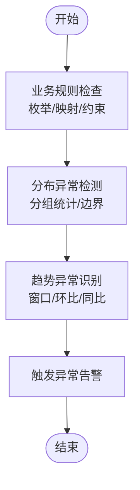
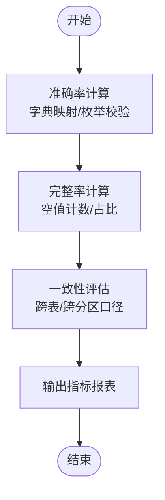
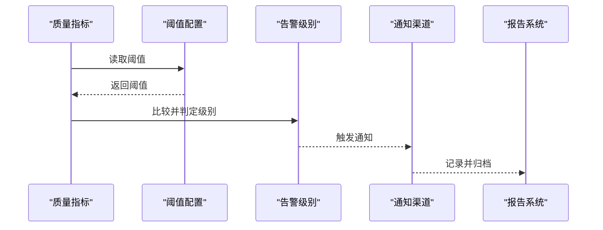
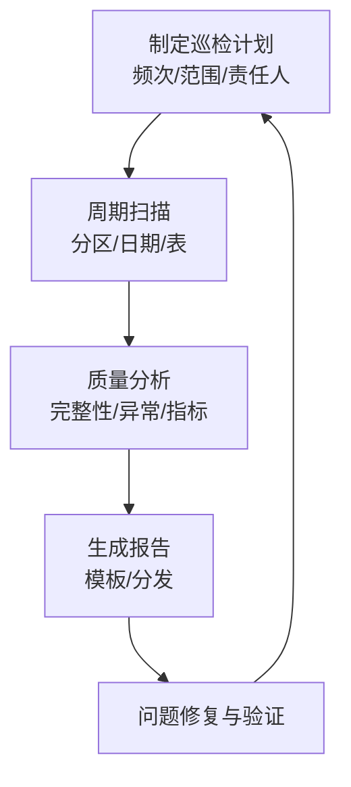
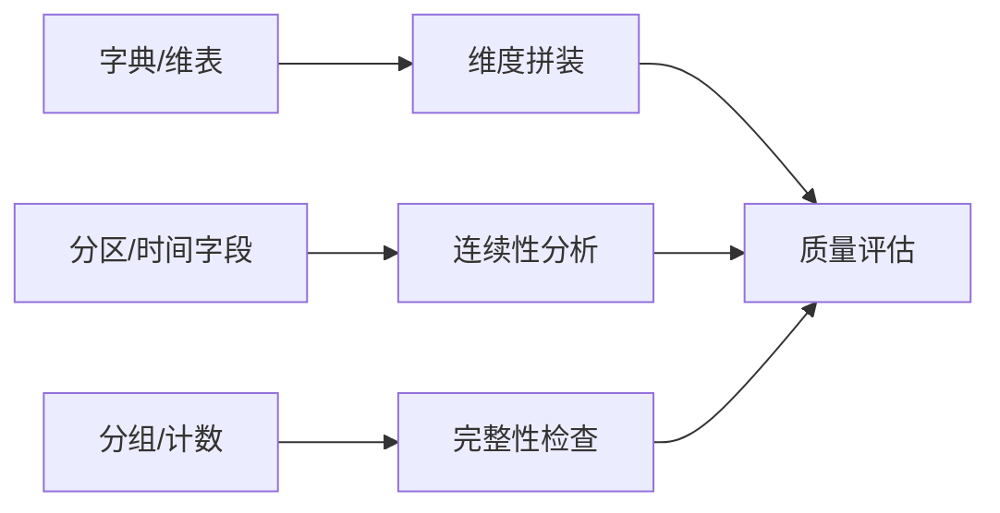

# 数据质量监控

<cite>
**本文引用的文件**
- [basic.sql](file://basic.sql)
- [console.sql](file://console.sql)
- [gmall-0906.sql](file://gmall-0906.sql)
- [high.sql](file://high.sql)
- [middle.sql](file://middle.sql)
</cite>

## 目录
1. [引言](#引言)
2. [项目结构](#项目结构)
3. [核心组件](#核心组件)
4. [架构总览](#架构总览)
5. [详细组件分析](#详细组件分析)
6. [依赖分析](#依赖分析)
7. [性能考量](#性能考量)
8. [故障排查指南](#故障排查指南)
9. [结论](#结论)
10. [附录](#附录)

## 引言
本指南面向数据工程师与分析师，系统化阐述如何基于仓库中的 SQL 示例构建“数据质量监控体系”。内容覆盖：
- 数据完整性检查：空值检测、重复数据识别、数据范围校验
- 异常数据检测：业务规则检查、分布与趋势异常识别
- 告警机制：阈值设定、告警级别与通知渠道
- 质量指标：准确率、完整率、一致性等关键指标的定义与计算
- 报告与巡检：质量报告生成与定期检查流程
- 常见问题诊断与修复

上述实践以仓库内 SQL 文件为依据，提炼可复用的监控思路与实现路径。

## 项目结构
仓库包含多个 SQL 文件，分别展示不同主题的查询与分析能力：
- basic.sql：基础函数、日期处理、集合与开窗函数示例
- console.sql：教学练习与多表联结、聚合、排名等常用模式
- gmall-0906.sql：电商仓维表建模与维度拼装示例
- high.sql：在线人数、会话切分、连续登录等复杂时序分析
- middle.sql：连续下单、累计消费、同比环比等趋势与分布分析

**章节来源**
- file://basic.sql#L1-L120
- file://console.sql#L1-L120
- file://gmall-0906.sql#L1-L120
- file://high.sql#L1-L60
- file://middle.sql#L1-L60

## 核心组件
围绕数据质量监控，建议将工作拆分为以下核心组件：
- 数据完整性检查器：负责空值、重复、范围校验
- 异常检测引擎：负责业务规则、分布与趋势异常
- 质量指标计算器：负责准确率、完整率、一致性等指标
- 告警与报告系统：负责阈值、级别、通知与报告生成
- 巡检与修复流程：负责问题定位、修复与回归验证

这些组件在仓库 SQL 中均有对应的实现思路与范式可借鉴。

**章节来源**
- file://basic.sql#L680-L740
- file://console.sql#L1-L120
- file://gmall-0906.sql#L1-L120
- file://high.sql#L1-L60
- file://middle.sql#L1-L60

## 架构总览
下图展示从原始数据到质量报告的端到端流程，以及各组件间的交互关系。

## 详细组件分析

### 组件A：数据完整性检查
目标：确保数据在进入下游前满足基本完整性要求。
- 空值检测：利用空值处理函数与条件过滤，识别缺失字段或格式错误导致的空值
- 重复数据识别：通过去重、分组计数、窗口函数标记等方式发现重复
- 数据范围验证：结合日期/数值函数与业务上下文，限定合理区间

实现要点与参考路径：
- 空值处理与格式校验：参考日期函数与空值替换模式
  - 参考路径：file://basic.sql#L680-L740
- 重复识别与去重：参考分组计数与窗口标记
  - 参考路径：file://console.sql#L120-L220
  - 参考路径：file://high.sql#L140-L210
- 范围校验：参考日期差、月份提取、格式转换
  - 参考路径：file://basic.sql#L720-L800
  - 参考路径：file://console.sql#L120-L220

**图表来源**
- [basic.sql](file://basic.sql#L680-L800)
- [console.sql](file://console.sql#L120-L220)
- [high.sql](file://high.sql#L140-L210)

**章节来源**
- file://basic.sql#L680-L800
- file://console.sql#L120-L220
- file://high.sql#L140-L210

### 组件B：异常数据检测
目标：识别业务规则异常、分布异常与趋势异常。
- 业务规则检查：基于表结构与业务字典，校验枚举值、映射关系、约束
- 分布异常检测：通过分组统计、百分位、箱线图边界等识别离群
- 趋势异常识别：基于时间序列窗口、移动平均、环比/同比变化

实现要点与参考路径：
- 业务规则与映射：参考维表建模与字典关联
  - 参考路径：file://gmall-0906.sql#L1-L120
- 分布与趋势：参考连续性、累计与排名
  - 参考路径：file://high.sql#L1-L60
  - 参考路径：file://middle.sql#L1-L120

**图表来源**
- [gmall-0906.sql](file://gmall-0906.sql#L1-L120)
- [high.sql](file://high.sql#L1-L60)
- [middle.sql](file://middle.sql#L1-L120)

**章节来源**
- file://gmall-0906.sql#L1-L120
- file://high.sql#L1-L60
- file://middle.sql#L1-L120

### 组件C：质量指标计算
目标：量化数据质量，形成可追踪的关键指标。
- 准确率：字段取值与业务字典一致的比例
- 完整率：非空字段占比
- 一致性：跨表/跨分区的口径统一程度
- 异常率：异常样本占总样本比例

实现要点与参考路径：
- 完整率与异常率：参考空值处理与分组计数
  - 参考路径：file://basic.sql#L680-L740
  - 参考路径：file://console.sql#L120-L220
- 一致性：参考维表拼装与字典映射
  - 参考路径：file://gmall-0906.sql#L490-L700

**图表来源**
- [basic.sql](file://basic.sql#L680-L740)
- [console.sql](file://console.sql#L120-L220)
- [gmall-0906.sql](file://gmall-0906.sql#L490-L700)

**章节来源**
- file://basic.sql#L680-L740
- file://console.sql#L120-L220
- file://gmall-0906.sql#L490-L700

### 组件D：告警机制配置与管理
目标：建立可配置的阈值、级别与通知渠道。
- 阈值设置：针对完整性、异常、指标波动设定阈值
- 告警级别：严重/警告/提示分级
- 通知渠道：邮件/IM/工单系统集成

实现要点与参考路径：
- 阈值与级别：可在指标计算后增加条件判断与分层
  - 参考路径：file://middle.sql#L290-L360
- 通知与报告：结合报告生成流程进行分发
  - 参考路径：file://high.sql#L1-L60

**图表来源**
- [middle.sql](file://middle.sql#L290-L360)
- [high.sql](file://high.sql#L1-L60)

**章节来源**
- file://middle.sql#L290-L360
- file://high.sql#L1-L60

### 组件E：数据质量报告与定期巡检
目标：形成标准化报告与巡检流程，保障持续改进。
- 报告模板：完整性、异常、指标趋势
- 巡检频率：日/周/月
- 回归验证：修复后验证与对比

实现要点与参考路径：
- 报告生成：参考连续性与累计分析的结构化输出
  - 参考路径：file://high.sql#L1-L60
  - 参考路径：file://middle.sql#L1-L120
- 巡检流程：基于分区与日期字段的周期性扫描
  - 参考路径：file://basic.sql#L720-L800

**图表来源**
- [basic.sql](file://basic.sql#L720-L800)
- [high.sql](file://high.sql#L1-L60)
- [middle.sql](file://middle.sql#L1-L120)

**章节来源**
- file://basic.sql#L720-L800
- file://high.sql#L1-L60
- file://middle.sql#L1-L120

## 依赖分析
- 维表依赖：维度拼装依赖基础字典表，需确保字典更新与分区同步
  - 参考路径：file://gmall-0906.sql#L1-L120
- 时序依赖：连续性分析依赖去重与排序，需保证分区与时间字段一致性
  - 参考路径：file://high.sql#L140-L210
  - 参考路径：file://middle.sql#L120-L220
- 聚合依赖：完整性与指标计算依赖分组与计数，需关注空值处理
  - 参考路径：file://basic.sql#L680-L740
  - 参考路径：file://console.sql#L120-L220

**图表来源**
- [gmall-0906.sql](file://gmall-0906.sql#L1-L120)
- [high.sql](file://high.sql#L140-L210)
- [middle.sql](file://middle.sql#L120-L220)
- [basic.sql](file://basic.sql#L680-L740)
- [console.sql](file://console.sql#L120-L220)

**章节来源**
- file://gmall-0906.sql#L1-L120
- file://high.sql#L140-L210
- file://middle.sql#L120-L220
- file://basic.sql#L680-L740
- file://console.sql#L120-L220

## 性能考量
- 优先使用聚合函数与分区裁剪，避免不必要的全表扫描
  - 参考路径：file://console.sql#L420-L520
- 合理使用窗口函数与去重，减少重复计算
  - 参考路径：file://high.sql#L140-L210
- 控制子查询层级，必要时改写为 JOIN 以提升可读性与执行效率
  - 参考路径：file://console.sql#L1-L120

[本节为通用指导，无需特定文件引用]

## 故障排查指南
- 空值与格式问题：检查日期格式、空值替换与字段类型
  - 参考路径：file://basic.sql#L680-L740
- 重复数据：确认去重逻辑与分组键
  - 参考路径：file://high.sql#L140-L210
- 分布异常：核对分组统计与边界条件
  - 参考路径：file://middle.sql#L1-L120
- 维度不一致：核对字典映射与分区更新
  - 参考路径：file://gmall-0906.sql#L490-L700

**章节来源**
- file://basic.sql#L680-L740
- file://high.sql#L140-L210
- file://middle.sql#L1-L120
- file://gmall-0906.sql#L490-L700

## 结论
通过将仓库中的 SQL 范式转化为系统化的数据质量监控流程，可实现对完整性、异常与指标的全链路治理。建议以“检查-检测-评估-告警-报告-巡检”为主线，结合阈值与级别管理，形成可持续的质量闭环。

[本节为总结性内容，无需特定文件引用]

## 附录
- 常用实现路径索引
  - 空值与格式：file://basic.sql#L680-L740
  - 重复与去重：file://high.sql#L140-L210
  - 维表与字典：file://gmall-0906.sql#L1-L120
  - 连续性与时序：file://high.sql#L1-L60
  - 趋势与累计：file://middle.sql#L1-L120

[本节为索引性内容，无需特定文件引用]