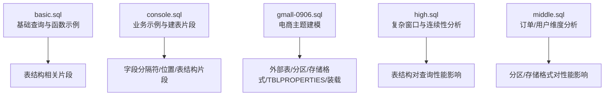
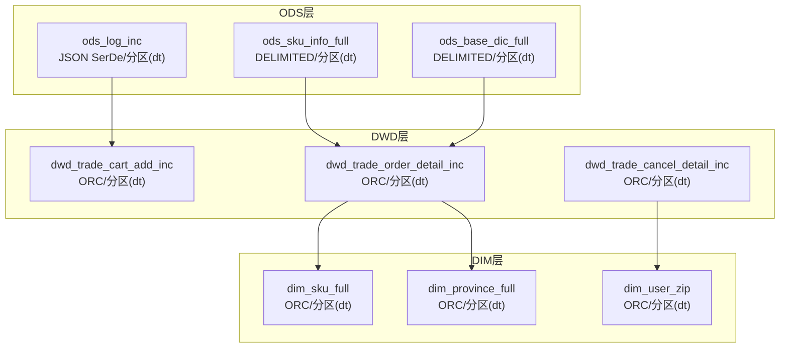
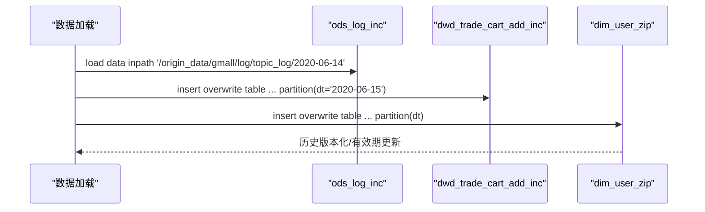
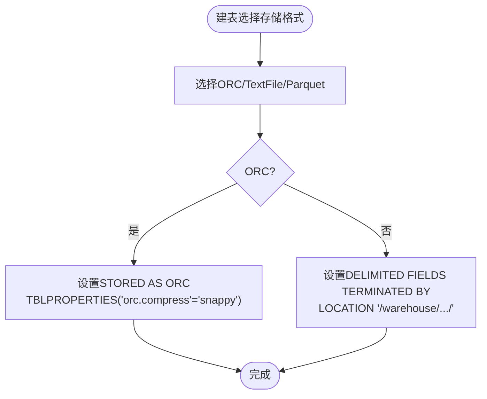
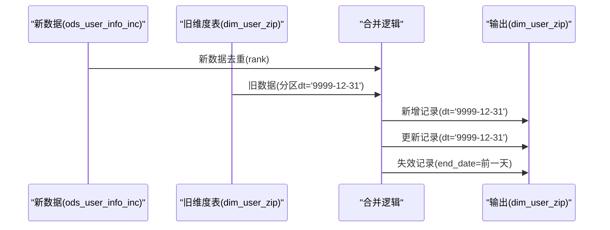

# 表结构管理

<cite>
**本文引用的文件**
- [basic.sql](file://basic.sql)
- [console.sql](file://console.sql)
- [gmall-0906.sql](file://gmall-0906.sql)
- [high.sql](file://high.sql)
- [middle.sql](file://middle.sql)
</cite>

## 目录
1. [引言](#引言)
2. [项目结构](#项目结构)
3. [核心组件](#核心组件)
4. [架构总览](#架构总览)
5. [详细组件分析](#详细组件分析)
6. [依赖分析](#依赖分析)
7. [性能考量](#性能考量)
8. [故障排查指南](#故障排查指南)
9. [结论](#结论)
10. [附录](#附录)

## 引言
本文件围绕仓库中的HQL脚本，系统梳理表结构管理的关键实践，覆盖：
- Hive表的创建、修改与删除
- 分区表的设计与维护
- 存储格式选择与配置（TextFile、ORC、Parquet）
- 分区策略最佳实践（字段选择、数量控制、压缩配置）
- 表属性设置与优化（TBLPROPERTIES、存储参数）
- 结构变更迁移策略与数据一致性保障
- 统计信息收集与更新

上述内容均基于仓库中实际存在的建表、分区、存储格式与TBLPROPERTIES配置示例进行归纳总结。

## 项目结构
仓库包含多个SQL脚本，分别展示了不同层次的建模与表结构实践：
- basic.sql：基础查询与函数示例，包含少量表结构相关片段
- console.sql：业务示例与建表片段，展示字段分隔符、位置等
- gmall-0906.sql：电商主题的完整建模，涵盖外部表、分区、存储格式、TBLPROPERTIES、插入装载等
- high.sql：复杂窗口与连续性分析，间接体现表结构设计对查询性能的影响
- middle.sql：订单与用户维度的连续登录、排名等分析，体现分区与存储格式对性能的作用

**章节来源**
- file://basic.sql#L1-L120
- file://console.sql#L150-L220
- file://gmall-0906.sql#L1-L120
- file://high.sql#L1-L60
- file://middle.sql#L1-L60

## 核心组件
- 外部表与分区表：gmall-0906.sql中大量演示了外部表的创建、分区字段定义与分区装载
- 存储格式与压缩：通过STORED AS与TBLPROPERTIES实现ORC压缩配置
- 字段分隔符与位置：console.sql展示了DELIMITED FIELDS TERMINATED BY与LOCATION
- 维度表与事务表：gmall-0906.sql中dim_*与dwd_*表的建模体现了维度与事务表的表结构差异
- 插入装载与动态分区：gmall-0906.sql中insert overwrite与动态分区模式设置

**章节来源**
- file://gmall-0906.sql#L20-L120
- file://gmall-0906.sql#L460-L520
- file://console.sql#L150-L220
- file://gmall-0906.sql#L1170-L1210

## 架构总览
gmall-0906.sql展示了典型的ODS-DWD-DIM三层建模：
- ODS层：外部表，按天分区，面向原始数据
- DWD层：事务事实表，按天分区，面向事务事实
- DIM层：维度表，按天分区或历史版本化（带有效期）

**图表来源**
- [gmall-0906.sql](file://gmall-0906.sql#L20-L120)
- [gmall-0906.sql](file://gmall-0906.sql#L1170-L1210)
- [gmall-0906.sql](file://gmall-0906.sql#L460-L520)
- [gmall-0906.sql](file://gmall-0906.sql#L800-L868)

**章节来源**
- file://gmall-0906.sql#L20-L120
- file://gmall-0906.sql#L460-L520
- file://gmall-0906.sql#L800-L868
- file://gmall-0906.sql#L1170-L1210

## 详细组件分析

### 组件A：分区表的创建与维护
- 创建分区表：ods_log_inc、ods_sku_info_full等均通过PARTITIONED BY定义分区字段dt
- 分区装载：使用load data inpath与insert overwrite table ... partition(dt='YYYY-MM-DD')
- 动态分区：通过设置hive.exec.dynamic.partition.mode=nonstrict实现动态分区插入

**图表来源**
- [gmall-0906.sql](file://gmall-0906.sql#L40-L60)
- [gmall-0906.sql](file://gmall-0906.sql#L1196-L1210)
- [gmall-0906.sql](file://gmall-0906.sql#L1080-L1110)

**章节来源**
- file://gmall-0906.sql#L40-L60
- file://gmall-0906.sql#L1196-L1210
- file://gmall-0906.sql#L1080-L1110

### 组件B：存储格式与压缩配置
- ORC格式：dim_sku_full、dim_province_full、dim_user_zip、dwd_trade_*等均使用STORED AS ORC
- 压缩配置：TBLPROPERTIES ('orc.compress' = 'snappy')
- TextFile/DELIMITED：console.sql中的order_summary与user_active使用DELIMITED FIELDS TERMINATED BY与LOCATION

**图表来源**
- [gmall-0906.sql](file://gmall-0906.sql#L490-L494)
- [gmall-0906.sql](file://gmall-0906.sql#L810-L815)
- [gmall-0906.sql](file://gmall-0906.sql#L926-L931)
- [console.sql](file://console.sql#L150-L220)

**章节来源**
- file://gmall-0906.sql#L490-L494
- file://gmall-0906.sql#L810-L815
- file://gmall-0906.sql#L926-L931
- file://console.sql#L150-L220

### 组件C：表属性与TBLPROPERTIES
- TBLPROPERTIES用于设置ORC压缩级别，如('orc.compress'='snappy')
- LOCATION用于指定HDFS路径，便于后续数据装载与分区管理
- ROW FORMAT DELIMITED用于文本格式表的字段分隔符与NULL定义

**章节来源**
- file://gmall-0906.sql#L490-L494
- file://gmall-0906.sql#L810-L815
- file://gmall-0906.sql#L926-L931
- file://console.sql#L150-L220

### 组件D：表结构变更与迁移策略
- 历史版本化维度表：dim_user_zip通过有效期(start_date/end_date)与分区(dt)实现历史版本化
- 变更检测与合并：使用full outer join比较新旧数据，生成新增、更新与失效记录
- 动态分区模式：通过设置hive.exec.dynamic.partition.mode=nonstrict支持动态分区插入

**图表来源**
- [gmall-0906.sql](file://gmall-0906.sql#L954-L1080)
- [gmall-0906.sql](file://gmall-0906.sql#L1080-L1170)

**章节来源**
- file://gmall-0906.sql#L954-L1080
- file://gmall-0906.sql#L1080-L1170

### 组件E：分区策略最佳实践
- 分区字段选择：按dt字符串分区，便于按天装载与查询裁剪
- 分区数量控制：建议按天分区，避免过多小文件；可通过分区裁剪减少扫描
- 分区压缩配置：ORC压缩配置在TBLPROPERTIES中集中管理，统一压缩策略

**章节来源**
- file://gmall-0906.sql#L40-L60
- file://gmall-0906.sql#L490-L494
- file://gmall-0906.sql#L810-L815

### 组件F：统计信息收集与更新
- 统计信息：仓库未直接展示ANALYZE语句，但可通过Hive统计信息接口收集表与分区统计
- 建议：对大表与高频分区定期收集统计，提升查询优化器的决策质量

[本节为通用指导，不直接分析具体文件]

## 依赖分析
- ODS层外部表依赖原始数据源与分区dt
- DWD层事务表依赖ODS层多张表的join与清洗
- DIM层维度表依赖ODS层与DWD层的装载与历史版本化

**图表来源**
- [gmall-0906.sql](file://gmall-0906.sql#L20-L120)
- [gmall-0906.sql](file://gmall-0906.sql#L1170-L1210)
- [gmall-0906.sql](file://gmall-0906.sql#L460-L520)

**章节来源**
- file://gmall-0906.sql#L20-L120
- file://gmall-0906.sql#L1170-L1210
- file://gmall-0906.sql#L460-L520

## 性能考量
- 存储格式：ORC相比TextFile具有更好的压缩与列式存储优势，适合OLAP场景
- 分区裁剪：按dt分区可显著减少扫描数据量
- 动态分区：合理设置动态分区模式，避免过度分区导致小文件问题
- 字段分隔符与NULL定义：DELIMITED配置需与数据源一致，避免解析错误

[本节提供通用指导，不直接分析具体文件]

## 故障排查指南
- 分区字段与数据格式不一致：检查分区字段类型与数据源格式，确保分区dt正确
- 动态分区失败：确认hive.exec.dynamic.partition.mode配置与分区字段设置
- ORC压缩异常：核对TBLPROPERTIES配置，确保orc.compress参数正确
- 字段分隔符不匹配：核对DELIMITED FIELDS TERMINATED BY与数据源一致

**章节来源**
- file://gmall-0906.sql#L1196-L1210
- file://gmall-0906.sql#L490-L494
- file://console.sql#L150-L220

## 结论
本仓库脚本系统性地展示了Hive表结构管理的关键实践：分区表的创建与维护、存储格式与压缩配置、TBLPROPERTIES的使用、结构变更的迁移策略与历史版本化、以及分区策略与性能优化。结合这些实践，可在生产环境中构建稳定、可维护、高性能的表结构体系。

## 附录
- 表结构管理清单
  - 明确分区字段与分区粒度
  - 选择合适的存储格式与压缩策略
  - 使用TBLPROPERTIES集中管理表属性
  - 设计结构变更迁移流程与数据一致性保障
  - 定期收集与更新统计信息

[本节为通用指导，不直接分析具体文件]