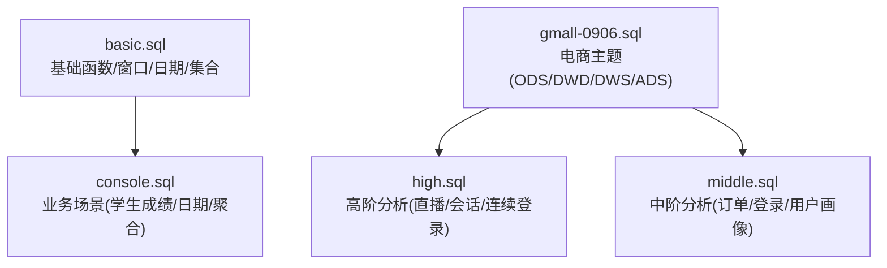
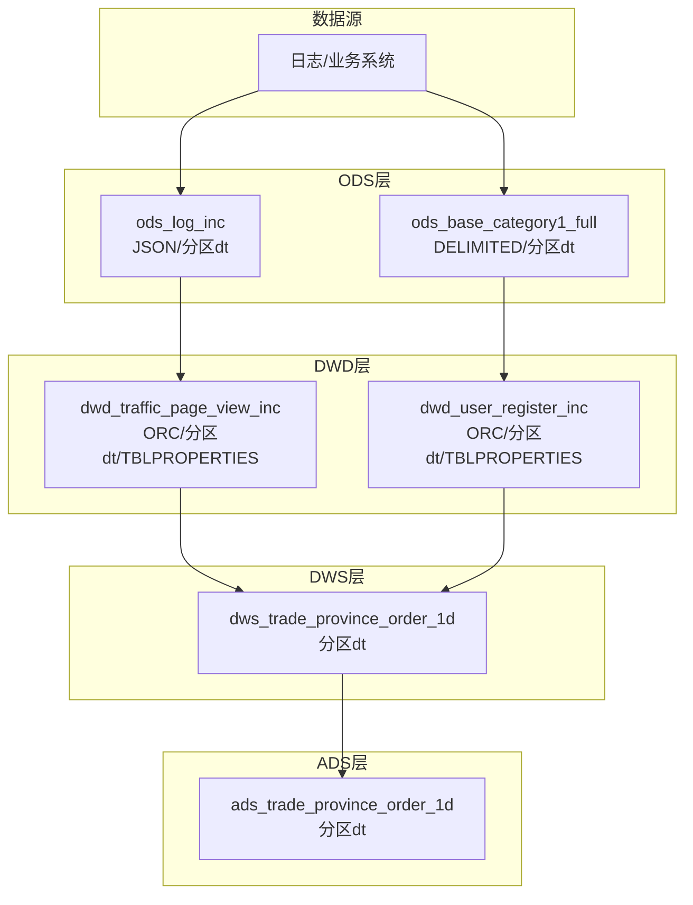
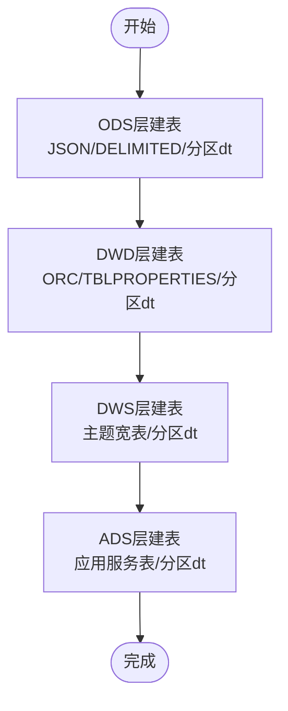
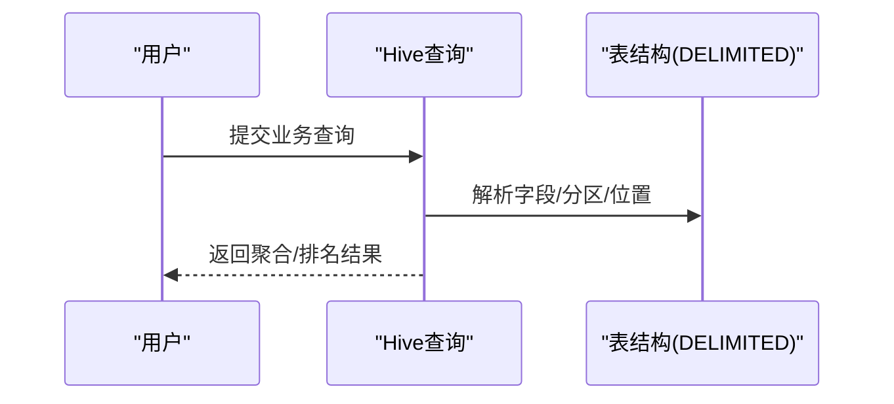
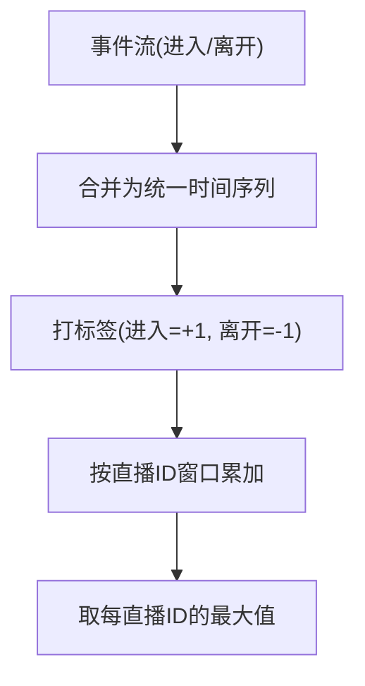
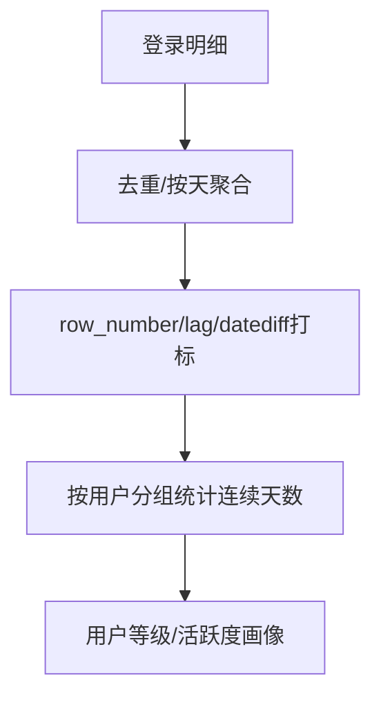

# 部署运维

<cite>
**本文引用的文件**
- [basic.sql](file://basic.sql)
- [console.sql](file://console.sql)
- [gmall-0906.sql](file://gmall-0906.sql)
- [high.sql](file://high.sql)
- [middle.sql](file://middle.sql)
</cite>

## 目录
1. [简介](#简介)
2. [项目结构](#项目结构)
3. [核心组件](#核心组件)
4. [架构总览](#架构总览)
5. [详细组件分析](#详细组件分析)
6. [依赖分析](#依赖分析)
7. [性能考量](#性能考量)
8. [故障排查指南](#故障排查指南)
9. [结论](#结论)
10. [附录](#附录)

## 简介
本文件面向系统管理员与数据工程师，基于仓库中的HQL脚本，构建一套可落地的Hive部署与运维操作手册。内容覆盖：
- Hive环境安装与集群部署要点
- 表结构管理最佳实践（分区策略、存储格式、索引）
- 数据质量监控与异常检测
- 日常运维任务（备份、恢复、扩容、故障处理）
- 性能监控与调优实操
- 运维自动化与工具推荐

说明：仓库未包含Hive安装与集群部署的直接脚本，但包含大量Hive建表、分区、存储格式、动态分区、执行引擎切换等配置示例，可用于指导生产环境的部署与运维。

## 项目结构
仓库包含五个SQL脚本，分别覆盖Hive基础语法、业务场景（学生成绩）、电商主题（gmall）、高阶分析（直播/会话/连续登录）与中阶分析（订单/登录/用户画像）等典型场景。这些脚本体现了Hive在实际业务中的建模与运行特征，是制定运维策略的重要依据。

图表来源
- [basic.sql](file://basic.sql#L1-L120)
- [console.sql](file://console.sql#L1-L120)
- [gmall-0906.sql](file://gmall-0906.sql#L1-L120)
- [high.sql](file://high.sql#L1-L60)
- [middle.sql](file://middle.sql#L1-L60)

章节来源
- [basic.sql](file://basic.sql#L1-L120)
- [console.sql](file://console.sql#L1-L120)
- [gmall-0906.sql](file://gmall-0906.sql#L1-L120)
- [high.sql](file://high.sql#L1-L60)
- [middle.sql](file://middle.sql#L1-L60)

## 核心组件
- 数据库与命名空间
  - 示例：创建数据库用于隔离业务域与环境。
  - 参考路径：[数据库创建](file://gmall-0906.sql#L1-L10)
- ODS层（原始数据层）
  - 外部表+JSON/DELIMITED格式+分区字段dt。
  - 参考路径：[ods_log_inc建表](file://gmall-0906.sql#L24-L42)，[ods_base_category1_full建表](file://gmall-0906.sql#L84-L106)
- DWD层（明细宽表层）
  - 外部表+ORC存储+分区dt+压缩属性。
  - 参考路径：[dwd_traffic_page_view_inc建表](file://gmall-0906.sql#L2550-L2567)，[dwd_user_register_inc建表](file://gmall-0906.sql#L3052-L3072)
- DWS层（主题宽表层）
  - 汇总宽表，按主题维度聚合，分区dt。
  - 参考路径：[dws_trade_province_order_1d建表](file://gmall-0906.sql#L3500-L3540)
- ADS层（应用服务层）
  - 面向报表/BI的最终表，分区dt。
  - 参考路径：[ads_trade_province_order_1d建表](file://gmall-0906.sql#L3540-L3600)
- 动态分区与执行引擎
  - 动态分区模式开启、Spark执行引擎切换。
  - 参考路径：[动态分区模式](file://gmall-0906.sql#L1199-L1200)，[执行引擎切换](file://gmall-0906.sql#L3048-L3049)

章节来源
- [gmall-0906.sql](file://gmall-0906.sql#L1-L120)
- [gmall-0906.sql](file://gmall-0906.sql#L24-L42)
- [gmall-0906.sql](file://gmall-0906.sql#L84-L106)
- [gmall-0906.sql](file://gmall-0906.sql#L2550-L2567)
- [gmall-0906.sql](file://gmall-0906.sql#L3052-L3072)
- [gmall-0906.sql](file://gmall-0906.sql#L3500-L3600)
- [gmall-0906.sql](file://gmall-0906.sql#L1199-L1200)
- [gmall-0906.sql](file://gmall-0906.sql#L3048-L3049)

## 架构总览
仓库脚本体现典型的湖仓分层架构：ODS/DWD/DWS/ADS，配合分区与存储格式，支撑离线批处理与报表查询。

图表来源
- [gmall-0906.sql](file://gmall-0906.sql#L24-L42)
- [gmall-0906.sql](file://gmall-0906.sql#L84-L106)
- [gmall-0906.sql](file://gmall-0906.sql#L2550-L2567)
- [gmall-0906.sql](file://gmall-0906.sql#L3052-L3072)
- [gmall-0906.sql](file://gmall-0906.sql#L3500-L3600)

## 详细组件分析

### 组件A：电商主题（gmall）分层建模
- ODS层
  - JSON格式：适用于半结构化日志数据，便于快速接入。
  - DELIMITED格式：适用于制表符分隔的文本数据。
  - 分区字段dt：按天分区，便于增量加载与裁剪。
- DWD层
  - ORC存储：列式存储+压缩，适合分析型查询。
  - TBLPROPERTIES：设置压缩算法，平衡压缩比与CPU开销。
- DWS/ADS层
  - 按主题维度聚合，面向报表与BI。

图表来源
- [gmall-0906.sql](file://gmall-0906.sql#L24-L42)
- [gmall-0906.sql](file://gmall-0906.sql#L2550-L2567)
- [gmall-0906.sql](file://gmall-0906.sql#L3052-L3072)
- [gmall-0906.sql](file://gmall-0906.sql#L3500-L3600)

章节来源
- [gmall-0906.sql](file://gmall-0906.sql#L24-L42)
- [gmall-0906.sql](file://gmall-0906.sql#L2550-L2567)
- [gmall-0906.sql](file://gmall-0906.sql#L3052-L3072)
- [gmall-0906.sql](file://gmall-0906.sql#L3500-L3600)

### 组件B：业务场景（学生成绩）与日期/聚合分析
- 日期函数与格式化：展示日期解析、格式化、差值等常用函数。
- 聚合与排名：dense_rank/row_number等窗口函数在业务统计中的应用。
- 表结构：DELIMITED格式+NULL定义+LOCATION定位。

图表来源
- [console.sql](file://console.sql#L150-L220)
- [console.sql](file://console.sql#L6329-L6390)

章节来源
- [console.sql](file://console.sql#L150-L220)
- [console.sql](file://console.sql#L6329-L6390)

### 组件C：高阶分析（直播/会话/连续登录）
- 直播在线人数：通过事件时间+标志位+窗口累加，计算每直播间的实时在线峰值。
- 会话划分：基于时间窗口与停留时长打标，生成会话标识。
- 连续登录：使用row_number/lag/datediff等组合，识别连续登录区间。

图表来源
- [high.sql](file://high.sql#L1-L60)

章节来源
- [high.sql](file://high.sql#L1-L60)

### 组件D：中阶分析（订单/登录/用户画像）
- 订单维度：按年/月/品类/用户等维度聚合，计算首年销量与金额。
- 登录维度：计算新增用户、活跃用户、连续登录天数等指标。
- 用户画像：基于登录/下单/活跃时间，计算用户生命周期与等级。

图表来源
- [middle.sql](file://middle.sql#L1-L120)
- [middle.sql](file://middle.sql#L1898-L2000)
- [middle.sql](file://middle.sql#L3132-L3260)

章节来源
- [middle.sql](file://middle.sql#L1-L120)
- [middle.sql](file://middle.sql#L1898-L2000)
- [middle.sql](file://middle.sql#L3132-L3260)

## 依赖分析
- 分层依赖
  - ODS依赖外部数据源；DWD依赖ODS；DWS依赖DWD；ADS依赖DWS。
- 存储与格式
  - ORC列式存储+压缩属性，提升查询性能与存储效率。
- 动态分区
  - 通过动态分区模式，按分区字段自动写入，减少手工维护成本。

图表来源
- [gmall-0906.sql](file://gmall-0906.sql#L24-L42)
- [gmall-0906.sql](file://gmall-0906.sql#L2550-L2567)
- [gmall-0906.sql](file://gmall-0906.sql#L3052-L3072)
- [gmall-0906.sql](file://gmall-0906.sql#L3500-L3600)

章节来源
- [gmall-0906.sql](file://gmall-0906.sql#L24-L42)
- [gmall-0906.sql](file://gmall-0906.sql#L2550-L2567)
- [gmall-0906.sql](file://gmall-0906.sql#L3052-L3072)
- [gmall-0906.sql](file://gmall-0906.sql#L3500-L3600)

## 性能考量
- 存储格式与压缩
  - ORC列式存储+snappy压缩，适合分析型查询；需权衡压缩比与CPU开销。
  - 参考路径：[ORC建表与压缩属性](file://gmall-0906.sql#L2550-L2567)，[ORC建表与压缩属性](file://gmall-0906.sql#L3052-L3072)
- 分区策略
  - 按天分区dt，便于增量加载与裁剪；建议结合分区裁剪与谓词下推。
  - 参考路径：[ods_log_inc分区](file://gmall-0906.sql#L24-L42)，[ods_base_category1_full分区](file://gmall-0906.sql#L84-L106)
- 动态分区
  - 开启动态分区模式，减少手工维护；注意合理设置分区数量与大小。
  - 参考路径：[动态分区模式](file://gmall-0906.sql#L1199-L1200)
- 执行引擎
  - 可切换至Spark执行引擎，提升大规模作业性能。
  - 参考路径：[执行引擎切换](file://gmall-0906.sql#L3048-L3049)
- 窗口函数与聚合
  - 合理使用窗口函数与聚合，避免不必要的笛卡尔积与大表连接。
  - 参考路径：[窗口函数示例](file://basic.sql#L120-L220)，[聚合与排名示例](file://console.sql#L1-L120)

章节来源
- [gmall-0906.sql](file://gmall-0906.sql#L24-L42)
- [gmall-0906.sql](file://gmall-0906.sql#L84-L106)
- [gmall-0906.sql](file://gmall-0906.sql#L2550-L2567)
- [gmall-0906.sql](file://gmall-0906.sql#L3052-L3072)
- [gmall-0906.sql](file://gmall-0906.sql#L1199-L1200)
- [gmall-0906.sql](file://gmall-0906.sql#L3048-L3049)
- [basic.sql](file://basic.sql#L120-L220)
- [console.sql](file://console.sql#L1-L120)

## 故障排查指南
- 常见问题与定位
  - 分区缺失或格式不一致：检查分区字段dt与数据格式，确保与建表一致。
    - 参考路径：[ods_log_inc分区与格式](file://gmall-0906.sql#L24-L42)
  - 动态分区失败：确认动态分区模式已开启，分区字段合法。
    - 参考路径：[动态分区模式](file://gmall-0906.sql#L1199-L1200)
  - 执行引擎切换后性能异常：回退或调整资源分配，观察执行计划。
    - 参考路径：[执行引擎切换](file://gmall-0906.sql#L3048-L3049)
  - 窗口函数报错：检查OVER子句与排序字段，确保分区与排序一致。
    - 参考路径：[窗口函数示例](file://basic.sql#L120-L220)
- 数据质量检查
  - 缺失值与异常值：使用COALESCE/NVL/ISNULL等函数进行清洗与兜底。
    - 参考路径：[空值处理示例](file://basic.sql#L340-L420)
  - 日期格式错误：严格校验输入格式，使用TO_DATE/DATE_FORMAT统一格式。
    - 参考路径：[日期函数示例](file://basic.sql#L60-L120)

章节来源
- [gmall-0906.sql](file://gmall-0906.sql#L24-L42)
- [gmall-0906.sql](file://gmall-0906.sql#L1199-L1200)
- [gmall-0906.sql](file://gmall-0906.sql#L3048-L3049)
- [basic.sql](file://basic.sql#L60-L120)
- [basic.sql](file://basic.sql#L340-L420)

## 结论
本仓库脚本展示了Hive在电商与业务分析场景中的建模与运行特征，为部署与运维提供了明确的实践指引。通过合理的分区策略、存储格式与动态分区配置，并结合窗口函数与聚合优化，可在保证数据质量的同时提升查询与作业性能。建议在生产环境中配套完善的数据质量监控与告警体系，确保数据链路稳定可靠。

## 附录

### A. Hive环境安装与集群部署（基于仓库实践的指导）
- 基本要求
  - Hadoop/HDFS：作为底层存储与资源调度。
  - Hive Metastore：持久化元数据，支持外部MySQL/PostgreSQL。
  - Yarn/Spark：作为执行引擎（仓库示例切换至Spark）。
- 部署要点
  - 元数据库初始化与权限配置。
  - HDFS目录规划与权限授权（/warehouse/gmall等）。
  - 动态分区与执行引擎参数在hive-site.xml中配置。
- 参考路径
  - [动态分区模式](file://gmall-0906.sql#L1199-L1200)
  - [执行引擎切换](file://gmall-0906.sql#L3048-L3049)

章节来源
- [gmall-0906.sql](file://gmall-0906.sql#L1199-L1200)
- [gmall-0906.sql](file://gmall-0906.sql#L3048-L3049)

### B. 表结构管理最佳实践
- 分区策略
  - 优先按天分区dt，便于增量与裁剪；复杂场景可引入复合分区（如dt/hour）。
  - 参考路径：[ods_log_inc分区](file://gmall-0906.sql#L24-L42)
- 存储格式选择
  - 分析型查询优先ORC，结合snappy压缩；写入频繁的临时表可用Parquet。
  - 参考路径：[ORC建表与压缩属性](file://gmall-0906.sql#L2550-L2567)
- 索引设计
  - Hive原生不支持B-Tree索引；可通过物化视图/预聚合表实现加速。
  - 参考路径：[DWS/ADS层建表](file://gmall-0906.sql#L3500-L3600)

章节来源
- [gmall-0906.sql](file://gmall-0906.sql#L24-L42)
- [gmall-0906.sql](file://gmall-0906.sql#L2550-L2567)
- [gmall-0906.sql](file://gmall-0906.sql#L3500-L3600)

### C. 数据质量监控与告警
- 数据完整性检查
  - 分区完整性：核对dt分区是否存在与数据量是否匹配。
  - 参考路径：[ods_log_inc分区](file://gmall-0906.sql#L24-L42)
- 异常数据检测
  - 日期格式校验：使用TO_DATE/DATE_FORMAT统一格式，避免NULL。
  - 空值兜底：使用COALESCE/NVL处理缺失值。
  - 参考路径：[日期函数与空值处理](file://basic.sql#L60-L120)，[空值处理示例](file://basic.sql#L340-L420)
- 告警机制
  - 建议结合外部监控系统（如Prometheus/Grafana/Zabbix）对分区缺失、延迟、异常值比例等指标进行告警。

章节来源
- [gmall-0906.sql](file://gmall-0906.sql#L24-L42)
- [basic.sql](file://basic.sql#L60-L120)
- [basic.sql](file://basic.sql#L340-L420)

### D. 日常运维任务
- 备份与恢复
  - 元数据备份：导出Hive Metastore数据库。
  - 数据备份：定期导出重要分区至对象存储或归档系统。
- 扩容与故障处理
  - 动态分区与执行引擎切换：根据负载动态调整资源与引擎。
  - 参考路径：[动态分区模式](file://gmall-0906.sql#L1199-L1200)，[执行引擎切换](file://gmall-0906.sql#L3048-L3049)
- 性能监控与调优
  - 执行计划分析：使用EXPLAIN/FROMAT查看物理执行计划。
  - 参考路径：[EXPLAIN示例](file://basic.sql#L238-L260)

章节来源
- [gmall-0906.sql](file://gmall-0906.sql#L1199-L1200)
- [gmall-0906.sql](file://gmall-0906.sql#L3048-L3049)
- [basic.sql](file://basic.sql#L238-L260)

### E. 运维自动化与工具推荐
- 自动化脚本
  - 分区同步：Shell/Python脚本定时同步新增分区。
  - 作业调度：Airflow/Superset/Ambari等。
- 工具推荐
  - 元数据管理：Atlas/Colleague。
  - 性能分析：Tez/Spark UI、Hive慢查询日志。
  - 监控告警：Grafana/Prometheus/Zabbix。

[本节为通用建议，无需特定文件引用]