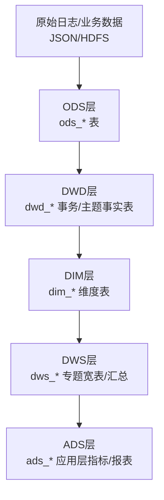
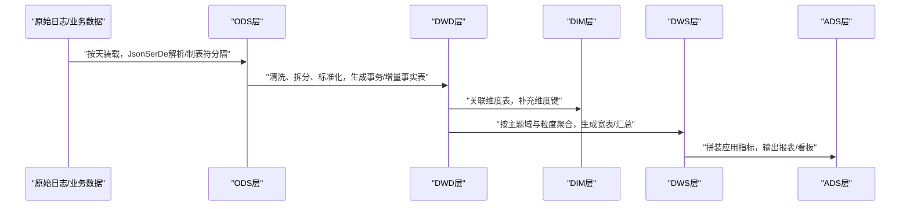

# 项目概述

<cite>
**本文引用的文件**
- [basic.sql](file://basic.sql)
- [console.sql](file://console.sql)
- [gmall-0906.sql](file://gmall-0906.sql)
- [high.sql](file://high.sql)
- [middle.sql](file://middle.sql)
</cite>

## 目录
1. [引言](#引言)
2. [项目结构](#项目结构)
3. [核心组件](#核心组件)
4. [架构总览](#架构总览)
5. [详细组件分析](#详细组件分析)
6. [依赖分析](#依赖分析)
7. [性能考量](#性能考量)
8. [故障排查指南](#故障排查指南)
9. [结论](#结论)
10. [附录](#附录)

## 引言
本项目以HQL为核心，围绕电商数据仓库实践，系统化展示了从原始日志到可分析数据的完整流程。项目以Hive为引擎，结合HDFS分布式存储与ORC列式存储格式，配合JsonSerDe解析半结构化日志，构建了覆盖ODS、DWD、DIM、DWS、ADS五层的数据仓库体系。通过规范化的分层设计与面向主题域的建模，项目能够支撑电商领域多维分析、指标计算与报表产出，兼顾初学者易懂与资深工程师可扩展的双重目标。

## 项目结构
项目由一组SQL脚本构成，分别聚焦于：
- 数据仓库分层建模与装载：gmall-0906.sql
- 基础函数与开窗分析：basic.sql
- 业务场景与实战练习：console.sql
- 连续性与会话分析：high.sql、middle.sql

图表来源
- [gmall-0906.sql](file://gmall-0906.sql#L21-L120)
- [gmall-0906.sql](file://gmall-0906.sql#L2412-L2444)
- [gmall-0906.sql](file://gmall-0906.sql#L851-L887)

章节来源
- [gmall-0906.sql](file://gmall-0906.sql#L21-L120)
- [gmall-0906.sql](file://gmall-0906.sql#L2412-L2444)
- [gmall-0906.sql](file://gmall-0906.sql#L851-L887)

## 核心组件
- ODS层（操作数据存储）
  - 作用：承接原始日志与全量/增量业务数据，不做清洗与聚合，仅做结构化落地。
  - 特征：分区字段dt用于按天装载；日志类表使用JsonSerDe解析；部分表使用制表符分隔字段。
  - 示例：ods_log_inc、ods_user_info_inc、ods_order_info_inc、ods_sku_info_full等。
  
- DWD层（数据明细层）
  - 作用：对ODS层数据进行清洗、拆分、标准化，形成主题域的事务事实表或准实时增量表。
  - 特征：按主题域建表，如交易域、互动域、流量域；使用ORC存储；按dt分区。
  - 示例：dwd_trade_order_detail_inc、dwd_interaction_favor_add_inc等。
  
- DIM层（维度层）
  - 作用：沉淀稳定维度，如商品、品牌、品类、地区、时间等，供上层宽表与指标表复用。
  - 特征：维度表通常按dt分区，存储为ORC，便于JOIN与跨域分析。
  - 示例：dim_sku_full、dim_activity_full、dim_province_full、dim_date等。
  
- DWS层（数据服务层）
  - 作用：面向主题域的宽表与汇总表，按粒度（用户、商品、地区等）进行聚合，支撑ADS层。
  - 特征：按dt分区，存储为ORC；常见包含最近N日汇总指标。
  - 示例：dws_trade_user_sku_order_1d、dws_traffic_page_visitor_page_view_nd等。
  
- ADS层（应用数据服务层）
  - 作用：面向最终分析与报表的指标表，直接服务于BI与看板。
  - 特征：按需建表，字段直接对应业务口径，便于快速查询。
  - 示例：ads_user_action等。

章节来源
- [gmall-0906.sql](file://gmall-0906.sql#L21-L120)
- [gmall-0906.sql](file://gmall-0906.sql#L2412-L2444)
- [gmall-0906.sql](file://gmall-0906.sql#L851-L887)

## 架构总览
HQL项目采用“ODS-DWD-DIM-DWS-ADS”的五层架构，结合Hive SQL完成ETL与指标计算，典型流程如下：

图表来源
- [gmall-0906.sql](file://gmall-0906.sql#L21-L120)
- [gmall-0906.sql](file://gmall-0906.sql#L2412-L2444)
- [gmall-0906.sql](file://gmall-0906.sql#L851-L887)

## 详细组件分析

### ODS层：原始数据接入与落盘
- 日志类表（ods_log_inc、ods_order_info_inc等）使用JsonSerDe解析半结构化日志，字段包含common、page、actions、displays、start、err等结构化片段，便于后续抽取与拆分。
- 全量/增量表（如ods_sku_info_full、ods_user_info_inc）使用制表符分隔字段，便于批量导入与分区装载。
- 分区策略：统一使用dt分区字段，便于按天装载与回溯。

章节来源
- [gmall-0906.sql](file://gmall-0906.sql#L21-L120)

### DWD层：主题域事实表与增量装载
- 交易域事实表（如dwd_trade_order_detail_inc）抽取订单明细、拆分金额、来源类型等关键字段，并按dt分区。
- 互动域事实表（如dwd_interaction_favor_add_inc）抽取收藏、评价、退款等行为事件，按dt分区。
- 增量表通过type字段标识bootstrap-insert或insert，配合分区装载实现准实时更新。

章节来源
- [gmall-0906.sql](file://gmall-0906.sql#L2412-L2444)

### DIM层：维度表与字典映射
- 商品维度（dim_sku_full）整合SKU、SPU、品牌、品类等信息，使用collect_set/named_struct等聚合函数构造数组结构，便于下游宽表拼接。
- 活动与优惠券维度（dim_activity_full、dim_coupon_full）通过字典表映射编码与名称，生成业务友好的维度字段。
- 时间维度（dim_date）提供日期、周、季度、工作日等维度属性，支撑多维分析。

章节来源
- [gmall-0906.sql](file://gmall-0906.sql#L851-L887)

### DWS层：主题域宽表与汇总
- 以“用户-商品-品类-地区”等多粒度聚合，生成最近7日/30日汇总指标，如下单次数、件数、金额等。
- 使用ORC存储与分区，提升查询与写入性能。

章节来源
- [gmall-0906.sql](file://gmall-0906.sql#L4282-L4327)
- [gmall-0906.sql](file://gmall-0906.sql#L4566-L4597)

### ADS层：应用指标与报表
- 面向BI与看板的指标表，直接输出业务口径指标，减少查询复杂度。
- 示例：ads_user_action等。

章节来源
- [gmall-0906.sql](file://gmall-0906.sql#L5318-L5321)

### 基础能力与分析范式
- 开窗函数与集合函数：通过count(*) over、row_number/dense_rank等实现排名、累计、滚动聚合；通过collect_set/collect_list构造数组维度。
- 日期与时间函数：统一使用hive内置日期函数进行格式化、差值与分区裁剪。
- JSON解析：get_json_object等函数用于半结构化日志字段提取。

章节来源
- [basic.sql](file://basic.sql#L1-L120)
- [basic.sql](file://basic.sql#L680-L720)

### 业务场景示例
- 连续登录与会话划分：基于时间戳与lag/row_number实现连续登录天数统计与会话切分。
- 用户累计消费与VIP等级：按用户累计消费金额进行区间分级。
- 首次下单后次日连续下单比率：通过row_number与datediff计算连续性。
- 商品销量与品类平均对比：按品类计算平均销量，筛选高于平均的商品。

章节来源
- [high.sql](file://high.sql#L1-L120)
- [middle.sql](file://middle.sql#L1-L120)
- [middle.sql](file://middle.sql#L296-L324)

## 依赖分析
- 存储与格式
  - ORC列式存储：提高压缩比与查询性能，适合大表与宽表。
  - JsonSerDe：解析半结构化日志，便于快速落地。
- 分区与装载
  - dt分区策略贯穿ODS/DWD/DIM/DWS/ADS，确保按天装载与回溯。
- 维度复用
  - DIM层维度表被DWS/ADS广泛复用，降低重复计算与存储成本。
- 主题域耦合
  - DWD层按域拆分，DWS层按粒度聚合，ADS层按业务口径输出，层次清晰、职责明确。

图表来源
- [gmall-0906.sql](file://gmall-0906.sql#L21-L120)
- [gmall-0906.sql](file://gmall-0906.sql#L2412-L2444)
- [gmall-0906.sql](file://gmall-0906.sql#L851-L887)

## 性能考量
- 存储格式
  - ORC列式存储与snappy压缩，显著降低I/O与磁盘占用，适合OLAP场景。
- 分区裁剪
  - dt分区在WHERE中使用，可有效减少扫描数据量。
- 聚合与去重
  - 在DWD层完成清洗与去重，避免在上层重复计算。
- 函数与表达式
  - 优先使用聚合函数与开窗函数，避免在SELECT中进行大量列运算，减少IO。

章节来源
- [gmall-0906.sql](file://gmall-0906.sql#L851-L887)
- [gmall-0906.sql](file://gmall-0906.sql#L2412-L2444)

## 故障排查指南
- 日期格式问题
  - 日期函数返回NULL时，检查输入格式与分隔符，确保与函数期望一致。
- 分区缺失或装载失败
  - 确认dt分区字段正确传入，检查分区目录是否存在与权限。
- JsonSerDe解析异常
  - 检查日志字段结构与序列化配置，确保字段与结构匹配。
- 排名与连续性计算
  - 使用row_number/dense_rank时注意去重与分区顺序；使用lag时注意默认值与空值处理。

章节来源
- [basic.sql](file://basic.sql#L70-L120)
- [gmall-0906.sql](file://gmall-0906.sql#L21-L120)

## 结论
HQL项目以Hive为核心，结合HDFS与ORC，构建了完整的电商数据仓库分层架构。通过ODS-DWD-DIM-DWS-ADS的清晰分工，项目实现了从原始日志到可分析数据的自动化流转，既满足电商领域的多维分析与指标计算需求，也为后续扩展与优化提供了坚实基础。建议在生产环境中持续完善分区策略、索引与物化视图，进一步提升查询性能与维护效率。

## 附录
- 技术栈与优势
  - Hive：SQL生态成熟，适合离线批处理与数据仓库。
  - HDFS：高吞吐、高可靠的大规模存储。
  - ORC：列式存储、压缩比高、查询性能优。
  - JsonSerDe：半结构化日志快速解析，降低ETL复杂度。
- 业务价值
  - 提升数据一致性与可追溯性，支撑精细化运营与决策分析。
  - 通过分层建模与主题域聚合，降低重复计算与存储成本。
  - 为BI与看板提供即取即用的指标表，缩短交付周期。